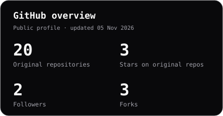
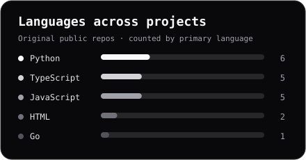
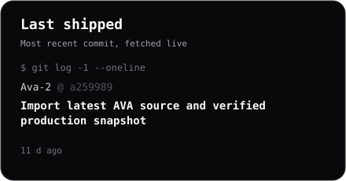

<p align="center">
  
</p>

<p align="center">
  
  <a href="https://github.com/coneldiablo?tab=followers"></a>
  <a href="https://github.com/coneldiablo?tab=repositories"></a>
  <a href="https://github.com/coneldiablo/Ava-2"></a>
</p>

### 👨‍💻 Обо мне

```python
class Coneldiablo:
    building = "AVA"
    languages = [
        "Python", "TypeScript", "JavaScript",
        "Go", "Bash", "HTML/CSS",
    ]
    focus = [
        "Voice AI",
        "CRM integrations",
        "Telegram bots",
    ]
    toolkit = [
        "React", "FastAPI", "aiogram",
        "Docker", "Linux", "Git",
    ]
```

🔊 **Голосовой AI** — ассистенты, телефония и сценарии обзвона.<br>
⚙️ **Автоматизация** — CRM, переписки, каталоги товаров и история клиента.<br>
🧩 **Fullstack** — от API и ботов до рабочего места менеджера.<br>
🌐 **Инфра** — контейнеризация, shell-автоматизация, сервисы на Go.

### 🛠️ Tech stack

<p align="center">
  
</p>

**Languages**


**Backend & bots**


**Frontend**


**Tools & infrastructure**


### 🚀 Что я делаю

| Проект | Что внутри |
| :--- | :--- |
| **[🔊 AVA 2](https://github.com/coneldiablo/Ava-2)** | Голосовой ассистент, CRM, переписки и каталог товаров. Python · React · TypeScript |
| **[🎧 Music Bot](https://github.com/coneldiablo/musicbot-control-center)** | Поиск и распознавание музыки, плейлисты, панель администрирования. Python · aiogram |
| **[🤍 Добрый Чек](https://github.com/coneldiablo/dobry-check)** | Открытый концепт платформы гуманитарных программ. JavaScript · [Демо ↗](https://coneldiablo.github.io/dobry-check/) |

### 📊 GitHub stats

<p align="center">
  
  
</p>
<p align="center">
  
  
</p>

### 🏆 Trophies

<p align="center">
  
</p>

### 📈 Activity graph

<p align="center">
  
</p>

### 🐍 Contribution snake

<picture>
  <source media="(prefers-color-scheme: dark)" srcset="assets/snake-dark.svg">
  <source media="(prefers-color-scheme: light)" srcset="assets/snake.svg">
  
</picture>

<p align="center">
  <a href="https://github.com/coneldiablo?tab=repositories"><b>Все проекты ↗</b></a>
  &nbsp; · &nbsp;
  <a href="https://github.com/coneldiablo/Ava-2/issues"><b>Обсудить AVA ↗</b></a>
</p>


