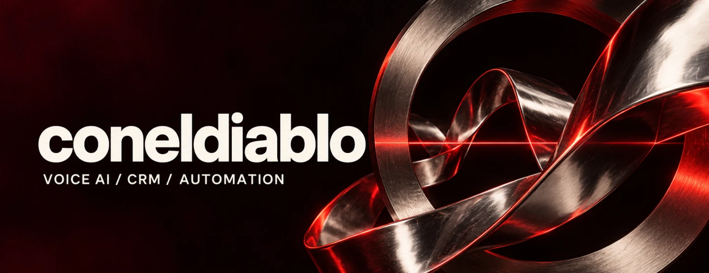
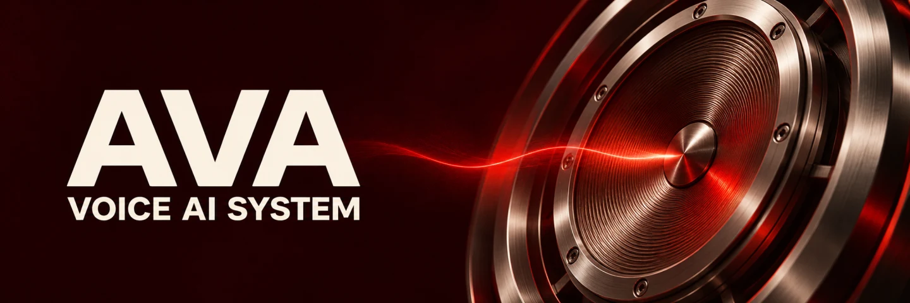

Делаю голосовых ассистентов и автоматизирую работу с клиентскими обращениями. В **AVA** звонки и переписки сходятся в одной CRM, где менеджер видит историю клиента.

## 01 / Главный проект

**AVA 2** объединяет голосового ассистента, CRM и каталог товаров. В проекте есть сценарии обзвона и рабочее место менеджера для переписок из разных каналов.

[Исходный код и архитектура ↗](https://github.com/coneldiablo/Ava-2#состав) · `Python` · `React` · `TypeScript` · `Docker`

## 02 / Ещё проекты

- **[Music Bot ↗](https://github.com/coneldiablo/musicbot-control-center)** — поиск и распознавание музыки в Telegram, плейлисты и панель администрирования.
- **[Добрый Чек ↗](https://github.com/coneldiablo/dobry-check)** — открытый концепт платформы для гуманитарных программ в заведениях. [Демо ↗](https://coneldiablo.github.io/dobry-check/)

## 03 / Активность

[Все репозитории ↗](https://github.com/coneldiablo?tab=repositories)
