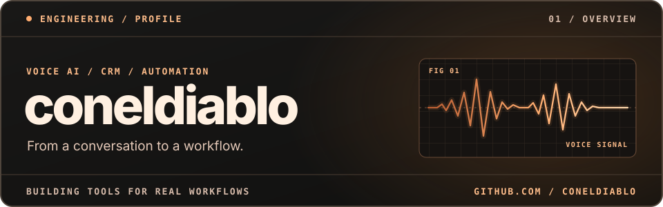
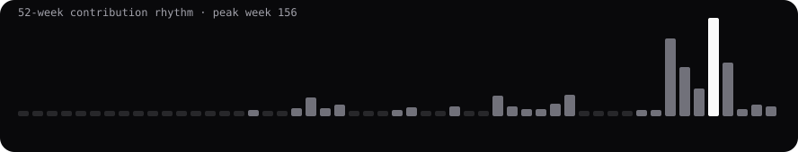

Разрабатываю голосовых ассистентов, CRM-интеграции и ботов. В **AVA** связываю телефонию, переписки и каталог товаров с рабочим местом менеджера.

## Избранные проекты

### [AVA 2](https://github.com/coneldiablo/Ava-2)

CRM и голосовой ассистент в одной системе. Обращения из разных каналов, история диалогов, знания о товарах и сценарии обзвона.

`Python` · `React` · `TypeScript` · `Docker`

### [Music Bot](https://github.com/coneldiablo/musicbot-control-center)

Telegram-бот для поиска и распознавания музыки с плейлистами и панелью администрирования.

`Python` · `aiogram` · `SQLite`

### [Добрый Чек](https://github.com/coneldiablo/dobry-check)

Открытый концепт платформы, где гости заведений могут знакомиться с гуманитарными программами. [Открыть демо](https://coneldiablo.github.io/dobry-check/)

`JavaScript` · `GitHub Pages`

## Активность на GitHub

[Все репозитории ↗](https://github.com/coneldiablo?tab=repositories)
